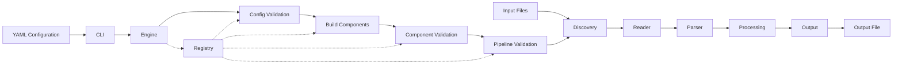

# Declarative Data Scanner

A declarative, YAML-driven data scanning pipeline for discovering files, reading their contents, parsing records, applying processing components, and writing results to configured outputs.

---

## Architecture



### Pipeline Flow

```text
YAML
  ↓
CLI
  ↓
Engine
  ↓
Validate Configuration
  ↓
Build Components
  ↓
Validate Pipeline
  ↓
Discovery
  ↓
Reader
  ↓
Parser
  ↓
Processing
  ↓
Output
```

The **Engine** controls pipeline construction and execution but does not perform the actual data processing.

The **Registry** provides centralized lookup for component and validator classes.

The **Validators** verify configuration and pipeline correctness before data processing begins.

Each component receives the previous component's output:

```python
data = component.execute(data)
```

The meaning of `data` depends on the stage being executed.

---

## Features

* **Declarative YAML Configuration** — Define the pipeline without changing Python code.
* **Dynamic Pipeline Construction** — Components are created from YAML definitions.
* **Registry-Based Resolution** — Components are resolved using `(stage, type)`.
* **Common Component Interface** — All components inherit from `Component`.
* **Composable Processing** — Multiple processing components can be chained in YAML order.
* **Pre-Execution Validation** — Configuration, component definitions, and pipeline structure are validated before execution.
* **Extensible** — New components and validators can be registered without changing the Engine's core orchestration logic.

---

## Project Structure

```text
declarative_data_scanner/
├── modules/
│   ├── discovery/
│   │   └── glob.py
│   ├── reader/
│   │   └── text.py
│   ├── parser/
│   │   └── regex.py
│   ├── processing/
│   │   └── filter.py
│   ├── output/
│   │   └── csv.py
│   └── base.py
├── validators/
│   ├── config.py
│   ├── component.py
│   └── pipeline.py
├── tests/
│   ├── modules/
│   ├── validators/
│   ├── test_engine.py
│   ├── test_pipeline.py
│   └── test_registry.py
├── configs/
│   └── example.yaml
├── cli.py
├── config.syntax.yaml
├── engine.py
├── registry.py
├── pytest.ini
├── README.md
└── requirements.txt
```

---

## Components

The current implementation contains the following components:

| Stage      | Type     | Component         | Responsibility                          |
| ---------- | -------- | ----------------- | --------------------------------------- |
| Discovery  | `glob`   | `GlobDiscovery`   | Finds input files using a glob pattern  |
| Reader     | `text`   | `TextReader`      | Reads discovered files                  |
| Parser     | `regex`  | `RegexParser`     | Extracts structured records using regex |
| Processing | `filter` | `FilterProcessor` | Filters records by field value          |
| Output     | `csv`    | `CSVOutput`       | Writes records to CSV                   |

Additional components such as directory discovery, binary readers, JSON parsing, type casting, field renaming, and DuckDB output can be added using the same component architecture.

### Component Interface

All components inherit from the common `Component` base class:

```python
class Component(ABC):
    stage: str
    type: str

    def __init__(self, config=None):
        self.config = config or {}

    @abstractmethod
    def execute(self, data):
        ...
```

Each component therefore provides:

```text
stage
type
execute(data)
```

`stage` and `type` identify the component for Registry resolution, while `execute(data)` defines its runtime behavior.

---

## Data Flow

The runtime data changes between stages:

```text
Input Files
    ↓
Discovery
    ↓
list of file paths
    ↓
Reader
    ↓
file contents / documents
    ↓
Parser
    ↓
list of records
    ↓
Processing
    ↓
processed records
    ↓
Output
    ↓
Output File
```

For example, `GlobDiscovery` may return:

```python
[
    "data/logs/app1.log",
    "data/logs/app2.log",
]
```

`TextReader` converts the discovered paths into document contents.

`RegexParser` converts those contents into structured records.

Processing components modify or filter those records.

`CSVOutput` writes the resulting records to the configured output destination.

---

## Configuration

The scanner is configured declaratively through YAML.

### Example Configuration

```yaml
scan:
  discovery:
    type: glob
    config:
      path: ./data/logs/*.log

  reader:
    type: text
    config:
      encoding: utf-8

  parser:
    - type: regex
      config:
        pattern: '(?P<date>\S+)\s+(?P<level>\w+)\s+(?P<status_code>\d+)'

  processing:
    - type: filter
      config:
        field: level
        equals: ERROR

  output:
    type: csv
    config:
      path: ./data/output/errors.csv
```

### Configuration Files

```text
configs/
└── example.yaml

config.syntax.yaml
```

* **`configs/example.yaml`** — Real, runnable scanner configuration.
* **`config.syntax.yaml`** — Reference syntax describing the supported configuration structure.

### Stage Cardinality

```text
discovery   → one
reader      → one
parser      → one or more
processing  → zero or more
output      → one
```

Processing components execute in the order defined by YAML.

For example, multiple filters become sequential components in the generated pipeline.

---

## Validation

Validation occurs before data processing begins.

```text
Configuration
      ↓
ConfigValidator
      ↓
Build Components
      ↓
ComponentValidator
      ↓
PipelineValidator
      ↓
Execution
```

### Validators

| Validator            | Responsibility                                                                                      |
| -------------------- | --------------------------------------------------------------------------------------------------- |
| `ConfigValidator`    | Validates required configuration structure and stages                                               |
| `ComponentValidator` | Validates component definitions, registered types, stage compatibility, and component configuration |
| `PipelineValidator`  | Validates the constructed pipeline and stage ordering                                               |

The current pipeline must start with `discovery` and end with `output`.

Invalid configurations prevent pipeline execution.

---

## Registry

The Registry provides centralized lookup for components and validators.

```text
                         Registry
                        /        \
                       /          \
              Components        Validators
                   │                 │
                   ▼                 ▼
            Component Lookup   Validator Lookup
                   │                 │
                   └────────┬────────┘
                            ↓
                          Engine
```

### Component Lookup

Components are resolved using:

```text
(stage, type)
```

For example:

```text
("discovery", "glob")       → GlobDiscovery
("reader", "text")          → TextReader
("parser", "regex")         → RegexParser
("processing", "filter")    → FilterProcessor
("output", "csv")           → CSVOutput
```

### Validator Lookup

Validators use named keys:

```text
"config"
"component"
"pipeline"
```

The Registry acts as the central catalog used by the Engine to resolve the required components and validators.

---

## Pipeline Construction

The Engine converts the configured component definitions into component instances.

```text
YAML Component Definitions
          ↓
      Registry Lookup
          ↓
   Component Instances
          ↓
     Executable Pipeline
```

For the example configuration, the resulting pipeline is conceptually:

```text
GlobDiscovery
      ↓
TextReader
      ↓
RegexParser
      ↓
FilterProcessor
      ↓
CSVOutput
```

Each configured component creates an independent instance. Therefore, the same component type can appear multiple times with different configurations.

---

## Usage

Execute commands from the project root.

### Installation

```bash
pip install -r requirements.txt
```

### Run

```bash
python cli.py --config configs/example.yaml
```

---

## Testing

The test suite is divided according to system responsibilities.

### Component Tests

Tests individual components independently:

```text
Configuration
     ↓
Component
     ↓
Expected Output
```

### Validator Tests

Tests validators independently:

```text
Configuration
     ↓
Validator
     ↓
Expected Validation Result
```

### Engine Tests

Tests Engine orchestration:

```text
Configuration
     ↓
Engine
     ↓
Validation
     ↓
Component Resolution
     ↓
Pipeline Construction
     ↓
Execution
```

### Pipeline Tests

Tests the complete YAML-driven execution flow:

```text
YAML
 ↓
Engine
 ↓
Validation
 ↓
Component Resolution
 ↓
Pipeline Construction
 ↓
Execution
 ↓
Output
```

Run the test suite:

```bash
python -m pytest tests/
```

With coverage:

```bash
python -m pytest --cov=. tests/
```

---

## Extension

New functionality is added as a component for the appropriate stage.

```text
Implement Component
       ↓
Define stage + type
       ↓
Implement execute()
       ↓
Register Component
       ↓
Use Component Type in YAML
       ↓
Engine Resolves Component
       ↓
Pipeline Executes
```

Example:

```python
class JsonParser(Component):
    stage = "parser"
    type = "json"

    def execute(self, data):
        ...
```

Register it:

```python
registry.register(JsonParser)
```

Then configure it in YAML:

```yaml
parser:
  - type: json
    config:
      ...
```

The Engine remains unchanged because component resolution and execution are handled through the common component interface and Registry.
