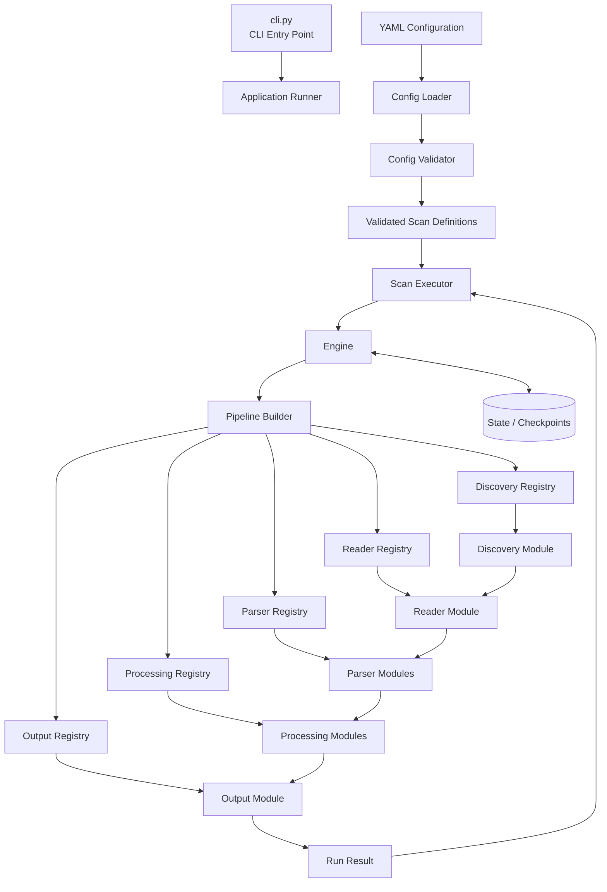

# Declarative Data Scanner

A declarative, YAML-driven data scanning and ingestion engine for discovering input data, reading and parsing records, applying configurable processing modules, persisting results, and maintaining incremental execution state.

The system separates **configuration from execution**. A YAML configuration defines one or more scans, while the engine dynamically builds and executes the required pipeline from registered stage implementations.

---

## Architecture



### Architecture Flow

The system is divided into two major responsibilities:

```text
Configuration
      ↓
Application Execution
      ↓
Pipeline Construction
      ↓
Pipeline Execution
```

The **CLI does not contain pipeline logic**. It submits a YAML configuration to the application layer.

The application layer:

1. Loads the YAML file.
2. Validates the complete configuration.
3. Reads all scan definitions.
4. Executes the scans sequentially.
5. Reports the result of each scan.

For each scan, the **Engine**:

1. Reads the scan definition.
2. Resolves the required implementations from registries.
3. Builds the execution pipeline.
4. Executes the pipeline.
5. Updates state/checkpoints.
6. Produces a run result.

For the initial implementation, scans execute sequentially:

```text
Scan A
  ↓
Build
  ↓
Execute
  ↓
Finish

Scan B
  ↓
Build
  ↓
Execute
  ↓
Finish

Scan C
  ↓
Build
  ↓
Execute
  ↓
Finish
```

Parallel scan execution can be introduced later as an execution strategy without changing the individual stage contracts.

---

## Core Pipeline

A scan represents one configurable ingestion workflow.

```text
Source
  ↓
Discovery
  ↓
Reader
  ↓
Parser
  ↓
Processing
  ↓
Output
```

The complete execution model is:

```text
Input Source
    ↓
Discovery
    ↓
InputUnit
    ↓
Reader
    ↓
Raw Data
    ↓
Parser
    ↓
Record Stream
    ↓
Processing
    ↓
Processed Record Stream
    ↓
Output
    ↓
Persisted Data
```

State is maintained alongside execution:

```text
                 State
                   ↕
Discovery → Reader → Parser → Processing → Output
```

State is not treated as a normal transformation stage. It records execution progress, checkpoints, failures, and other metadata required for incremental processing and recovery.

---

# Design Principles

### 1. Declarative

The YAML configuration describes **what should be executed**.

The engine decides **how the configured pipeline is constructed and executed**.

### 2. Modular

Each stage has its own interface and implementation registry.

### 3. Extensible

New implementations can be added without modifying existing implementations.

### 4. Stage-Specific Contracts

Different stages have different responsibilities and therefore different interfaces.

There is no requirement for every module to implement one oversized universal interface.

### 5. Configuration-Driven Resolution

The engine resolves implementations from configuration:

```yaml
type: regex_matcher
```

becomes:

```text
Parser Registry
      ↓
regex_matcher
      ↓
RegexMatcher
```

### 6. Sequential First

The initial execution model is sequential.

The architecture does not prevent future parallel execution.

### 7. Incremental

Processing state and checkpoints are built into the execution model.

### 8. Bounded Memory

The pipeline should process records/chunks incrementally rather than requiring an entire input file to be loaded into memory.

---

# Project Structure

```text
declarative_data_scanner/

├── data/                              # Local generated data
├── state/                             # Checkpoints and execution state
│
├── configs/                           # Example YAML configurations
│   ├── application_logs.yaml
│   ├── nginx_logs.yaml
│   └── json_data.yaml
│
├── tests/
│   ├── configs/
│   │   ├── valid.yaml
│   │   └── invalid.yaml
│   │
│   ├── engine/
│   ├── config/
│   │
│   └── stages/
│       ├── discovery/
│       ├── reader/
│       ├── parser/
│       ├── processing/
│       └── output/
│
├── config/
│   ├── loader.py                      # YAML loading
│   ├── schema.py                      # Configuration models
│   └── validator.py                   # Configuration validation
│
├── engine/
│   ├── engine.py                      # Per-scan engine
│   ├── builder.py                     # Pipeline construction
│   ├── pipeline.py                    # Built pipeline representation
│   └── runner.py                      # Pipeline execution
│
├── stages/
│   │
│   ├── discovery/
│   │   ├── base.py                    # Discovery interface
│   │   ├── registry.py                # Discovery registry
│   │   ├── glob.py                    # Glob implementation
│   │   ├── directory.py               # Directory implementation
│   │   └── api.py                     # API implementation
│   │
│   ├── reader/
│   │   ├── base.py                    # Reader interface
│   │   ├── registry.py                # Reader registry
│   │   ├── text.py                    # Text reader
│   │   ├── binary.py                  # Binary reader
│   │   └── ...
│   │
│   ├── parser/
│   │   ├── base.py                    # Parser interface
│   │   ├── registry.py                # Parser registry
│   │   ├── regex_matcher.py           # Regex matching module
│   │   ├── json_decoder.py            # JSON decoding module
│   │   ├── csv_decoder.py             # CSV decoding module
│   │   ├── extractor.py               # Field extraction module
│   │   ├── normalizer.py              # Record normalization module
│   │   └── ...
│   │
│   ├── processing/
│   │   ├── base.py                    # Processing interface
│   │   ├── registry.py                # Processing registry
│   │   ├── filter.py                  # Filtering module
│   │   ├── mapper.py                  # Field mapping module
│   │   ├── cast.py                    # Type conversion module
│   │   ├── deduplicator.py            # Deduplication module
│   │   └── ...
│   │
│   └── output/
│       ├── base.py                    # Output interface
│       ├── registry.py                # Output registry
│       ├── duckdb.py                  # DuckDB output
│       ├── csv.py                     # CSV output
│       ├── parquet.py                 # Parquet output
│       └── ...
│
├── models/
│   ├── input_unit.py                  # Discovered input representation
│   ├── record.py                      # Standard record representation
│   ├── run.py                         # Run metadata
│   └── result.py                      # Execution result
│
├── state/
│   ├── manager.py                     # State management
│   └── checkpoint.py                  # Checkpoint representation
│
├── cli.py                             # CLI entrypoint
├── example.yaml                       # Example configuration
├── config.syntax.yaml                 # Configuration reference
├── README.md
├── pytest.ini
└── requirements.txt
```

---

# Execution Model

## CLI

The CLI provides the external entry point.

Example:

```bash
python cli.py --config example.yaml
```

The CLI is responsible for:

* reading command-line arguments
* locating the YAML configuration
* invoking the application runner
* displaying execution results
* returning an appropriate process exit code

The CLI does not construct individual pipeline modules.

---

## Application Runner

The application runner manages the complete YAML configuration.

```text
YAML
 ↓
Load
 ↓
Validate
 ↓
Scan 1 → Engine
 ↓
Scan 2 → Engine
 ↓
Scan 3 → Engine
 ↓
Execution Summary
```

Its responsibility is **multiple-scan orchestration**.

---

# Scan

A `Scan` is the declarative definition of one ingestion workflow.

Conceptually:

```text
Scan
├── Source
├── Discovery
├── Reader
├── Parser
├── Processing
├── Output
└── State
```

Example:

```yaml
scans:

  application_logs:

    source:
      type: file
      path: ./logs/application/*.log

    discovery:
      type: glob

    reader:
      type: text

    parser:
      modules:
        - type: regex_matcher
          config:
            pattern: "..."

        - type: log_extractor

    processing:
      modules:
        - type: filter
          config:
            field: level
            equals: ERROR

    output:
      type: duckdb
      path: ./data/logs.duckdb
      table: application_logs
```

Each scan is independent and can select different implementations.

---

# Engine

### `engine/engine.py`

The Engine is responsible for executing one validated scan definition.

Conceptually:

```text
Scan Definition
      ↓
Engine
      ↓
Pipeline Builder
      ↓
Built Pipeline
      ↓
Pipeline Runner
      ↓
Run Result
```

The Engine does not implement:

* regex parsing
* JSON decoding
* file discovery
* filtering
* database writing

Instead, it resolves those capabilities through registries.

---

# Pipeline Builder

### `engine/builder.py`

The Pipeline Builder converts a validated scan definition into executable modules.

Example:

```text
YAML

parser:
  modules:
    - type: regex_matcher
    - type: timestamp_normalizer
```

becomes:

```text
Parser Registry
      ↓
regex_matcher
      ↓
RegexMatcher

Parser Registry
      ↓
timestamp_normalizer
      ↓
TimestampNormalizer
```

The builder then constructs:

```text
Reader
   ↓
RegexMatcher
   ↓
TimestampNormalizer
   ↓
Processing
   ↓
Output
```

The builder is therefore responsible for **construction**, not execution.

---

# Pipeline Runner

### `engine/runner.py`

The Pipeline Runner executes an already-built pipeline.

Conceptually:

```text
Pipeline
   ↓
Stage 1
   ↓
Stage 2
   ↓
Stage 3
   ↓
Stage 4
```

The runner should not decide which implementation to use.

That decision belongs to the Pipeline Builder and registries.

---

# Extendable Stages

The pipeline is divided into independent stages.

Each stage has:

1. A stage-specific interface.
2. A registry.
3. One or more implementations.
4. Configuration validation.
5. A defined input/output contract.

---

# 1. Discovery Stage

### Responsibility

Determine **which input units should be processed**.

Discovery does not parse the contents of the input.

```text
Source
  ↓
Discovery
  ↓
InputUnit
```

### Contract

```text
Discovery
Input:
    Source configuration
    State/checkpoint information

Output:
    InputUnit stream
```

### Discovery Implementations

| Type            | Implementation          | Responsibility                    |
| --------------- | ----------------------- | --------------------------------- |
| `glob`          | `GlobDiscovery`         | Discover files matching a pattern |
| `directory`     | `DirectoryDiscovery`    | Discover files in a directory     |
| `new_file`      | `NewFileDiscovery`      | Discover previously unseen files  |
| `modified_file` | `ModifiedFileDiscovery` | Discover changed files            |
| `api`           | `APIDiscovery`          | Discover remote input units       |

### Files

```text
stages/discovery/
├── base.py
├── registry.py
├── glob.py
├── directory.py
├── new_file.py
└── api.py
```

### Adding a Discovery Implementation

```text
1. Implement Discovery contract.
2. Add implementation to registry.
3. Define configuration.
4. Register a unique type.
5. Use the type in YAML.
```

Example:

```yaml
discovery:
  type: glob
  config:
    pattern: "./logs/*.log"
```

---

# 2. Reader Stage

### Responsibility

Read the discovered input and provide raw data to the parser.

```text
InputUnit
    ↓
Reader
    ↓
Raw Data / Chunks
```

The Reader does not interpret application-specific fields.

### Contract

```text
Reader
Input:
    InputUnit

Output:
    Raw data stream / chunks
```

### Reader Implementations

| Type     | Implementation | Responsibility                |
| -------- | -------------- | ----------------------------- |
| `text`   | `TextReader`   | Read text input incrementally |
| `binary` | `BinaryReader` | Read binary input             |
| `line`   | `LineReader`   | Produce line-oriented input   |
| `stream` | `StreamReader` | Read streaming sources        |

### Files

```text
stages/reader/
├── base.py
├── registry.py
├── text.py
├── binary.py
├── line.py
└── stream.py
```

### Adding a Reader

Implement the Reader contract, register the implementation, and expose its type through configuration.

---

# 3. Parser Stage

The Parser stage converts raw input into structured records.

```text
Raw Input
    ↓
Parser
    ↓
Records
```

The Parser itself can be composed from multiple modules.

```text
Parser
├── Matcher
├── Decoder
├── Extractor
└── Normalizer
```

Not every parser requires every module.

---

## Parser Contract

```text
Parser Module
Input:
    Raw data / intermediate parser data

Output:
    Parser-compatible intermediate data
```

The final parser pipeline produces:

```text
Record Stream
```

---

## Parser Implementations

| Type                   | Implementation        | Responsibility                           |
| ---------------------- | --------------------- | ---------------------------------------- |
| `regex_matcher`        | `RegexMatcher`        | Match input against a configured pattern |
| `json_decoder`         | `JSONDecoder`         | Decode JSON input                        |
| `csv_decoder`          | `CSVDecoder`          | Decode CSV input                         |
| `extractor`            | `Extractor`           | Extract configured fields                |
| `normalizer`           | `Normalizer`          | Normalize fields into the record model   |
| `timestamp_normalizer` | `TimestampNormalizer` | Normalize timestamp values               |

### Files

```text
stages/parser/
├── base.py
├── registry.py
├── regex_matcher.py
├── json_decoder.py
├── csv_decoder.py
├── extractor.py
├── normalizer.py
└── timestamp_normalizer.py
```

### Example

```yaml
parser:
  modules:

    - type: regex_matcher
      config:
        pattern: "..."

    - type: extractor
      config:
        fields:
          timestamp: timestamp
          level: level
          message: message

    - type: timestamp_normalizer
      config:
        input_format: "%Y-%m-%d %H:%M:%S"
```

The engine builds:

```text
Raw Input
   ↓
RegexMatcher
   ↓
Extractor
   ↓
TimestampNormalizer
   ↓
Records
```

---

# 4. Processing Stage

Processing operates on structured records.

```text
Records
   ↓
Processing Modules
   ↓
Processed Records
```

The distinction is important:

> **Parsing understands the input format. Processing changes the resulting data.**

### Processing Contract

```text
Processing Module
Input:
    Record stream

Output:
    Record stream
```

### Processing Implementations

| Type          | Implementation | Responsibility                      |
| ------------- | -------------- | ----------------------------------- |
| `filter`      | `Filter`       | Remove records matching a condition |
| `select`      | `Selector`     | Keep selected fields                |
| `rename`      | `Renamer`      | Rename fields                       |
| `cast`        | `Caster`       | Convert field types                 |
| `map`         | `Mapper`       | Transform field values              |
| `derive`      | `Deriver`      | Create calculated fields            |
| `deduplicate` | `Deduplicator` | Remove duplicate records            |
| `aggregate`   | `Aggregator`   | Aggregate records                   |

### Files

```text
stages/processing/
├── base.py
├── registry.py
├── filter.py
├── select.py
├── rename.py
├── cast.py
├── mapper.py
├── derive.py
├── deduplicator.py
└── aggregator.py
```

### Example

```yaml
processing:
  modules:

    - type: filter
      config:
        field: level
        equals: ERROR

    - type: cast
      config:
        field: status_code
        target_type: integer

    - type: derive
      config:
        field: duration_seconds
        expression: "duration_ms / 1000"
```

The generated pipeline becomes:

```text
Records
   ↓
Filter
   ↓
Caster
   ↓
Deriver
   ↓
Processed Records
```

---

# 5. Output Stage

The Output stage persists processed records.

```text
Processed Records
       ↓
     Output
       ↓
  Destination
```

### Output Contract

```text
Output Module
Input:
    Record stream

Output:
    Write/Execution Result
```

### Output Implementations

| Type       | Implementation   | Responsibility                  |
| ---------- | ---------------- | ------------------------------- |
| `duckdb`   | `DuckDBOutput`   | Persist records into DuckDB     |
| `csv`      | `CSVOutput`      | Write records to CSV            |
| `parquet`  | `ParquetOutput`  | Write records to Parquet        |
| `json`     | `JSONOutput`     | Write records to JSON           |
| `postgres` | `PostgresOutput` | Persist records into PostgreSQL |

### Files

```text
stages/output/
├── base.py
├── registry.py
├── duckdb.py
├── csv.py
├── parquet.py
├── json.py
└── postgres.py
```

### Example

```yaml
output:
  type: duckdb
  config:
    path: ./data/logs.duckdb
    table: application_logs
```

---

# Stage Registry Model

Every extendable stage has its own registry.

```text
Discovery Registry
        │
        ├── glob
        ├── directory
        └── api

Reader Registry
        │
        ├── text
        ├── binary
        └── stream

Parser Registry
        │
        ├── regex_matcher
        ├── json_decoder
        ├── csv_decoder
        └── extractor

Processing Registry
        │
        ├── filter
        ├── cast
        ├── mapper
        └── deduplicator

Output Registry
        │
        ├── duckdb
        ├── csv
        └── parquet
```

The Engine does not directly instantiate implementation classes based on hardcoded logic.

Instead:

```text
Configuration
      ↓
Stage Registry
      ↓
Implementation Type
      ↓
Implementation
```

---

# Adding a New Module

Adding a new implementation should follow the same process for every stage.

For example, adding an XML parser:

```text
1. Create xml_decoder.py
2. Implement Parser contract
3. Define configuration
4. Register "xml_decoder"
5. Use it from YAML
```

Example:

```yaml
parser:
  modules:
    - type: xml_decoder
      config:
        root: records
```

No modification to the existing parser implementations is required.

The same principle applies to:

```text
New Discovery
New Reader
New Parser Module
New Processing Module
New Output
```

---

# Adding a New Stage

Adding a completely new stage is a larger architectural extension.

For example:

```text
Discovery
   ↓
Reader
   ↓
Parser
   ↓
Validation
   ↓
Processing
   ↓
Output
```

A new stage requires:

```text
1. Define the stage responsibility.
2. Define its input contract.
3. Define its output contract.
4. Define the stage interface.
5. Create its registry.
6. Add implementations.
7. Integrate the stage into Pipeline Builder.
8. Add configuration validation.
9. Add tests.
```

Unlike adding a new module, a new stage changes the pipeline model itself and therefore requires explicit engine integration.

---

# Input Unit

Discovery produces a common `InputUnit` representation.

A file-based input may contain:

```text
InputUnit
├── identity
├── location
├── size
├── modified_at
└── metadata
```

Example:

```text
InputUnit
    identity = application.log
    location = ./logs/application.log
    size = 250000
    modified_at = ...
```

The purpose of `InputUnit` is to prevent downstream stages from depending directly on a particular discovery mechanism.

For example:

```text
File Discovery → InputUnit
API Discovery  → InputUnit
Object Storage → InputUnit
```

The Reader receives the `InputUnit` rather than knowing how it was discovered.

---

# Record Model

Parser modules produce structured records.

A log-oriented record may contain:

```text
timestamp
source
host
service
level
event_type
message
request_id
user_id
status_code
duration
metadata
```

The record model should support:

* common fields
* optional fields
* parser-specific fields
* metadata

The Output stage consumes records rather than parser-specific objects.

---

# Record Flow

The fundamental data flow is:

```text
Raw Input
    ↓
Parser Modules
    ↓
Record Stream
    ↓
Processing Modules
    ↓
Processed Record Stream
    ↓
Output
```

A processing module should not need to know whether a record originated from:

```text
CSV
JSON
Nginx
Apache
Application Log
API
```

It operates on the common record representation.

---

# Streaming and Batching

The pipeline should avoid loading large inputs completely into memory.

Conceptually:

```text
Large Input
    ↓
Reader
    ↓
Chunk / Record Stream
    ↓
Parser
    ↓
Processing
    ↓
Output Batch
```

For example:

```text
1 GB file

Read 10 MB
    ↓
Parse
    ↓
Process
    ↓
Write

Read next 10 MB
    ↓
Parse
    ↓
Process
    ↓
Write
```

This allows the scanner to process large files with bounded memory.

Modules may internally use batching where required, while preserving the stage contract.

---

# Incremental Processing

Incremental processing is part of the core execution model.

Instead of processing the entire input during every execution:

```text
First Run

Input
0 ─────────────────────── 100000
                         ↑
                      checkpoint
```

The next execution can continue from the stored state:

```text
Second Run

Input
0 ─────────────────────── 100000 ───── 105000
                         processed       new
                                          ↓
                                       process
```

State may contain:

```text
run_id
input_identity
input_position
file_offset
last_processed_timestamp
status
checkpoint
errors
```

---

# State Management

State is maintained separately from transformation modules.

```text
                State Manager
                    ↕
Discovery → Reader → Parser → Processing → Output
```

The State Manager is responsible for:

* loading previous checkpoints
* storing progress
* updating checkpoints
* recording execution status
* supporting recovery
* preventing unnecessary reprocessing

The exact checkpoint strategy depends on the input source.

For files, a checkpoint may use:

```text
file identity + byte offset
```

For APIs, it may use:

```text
cursor / page token
```

For other sources, the state representation can be extended accordingly.

---

# Run

A `Scan` is a definition.

A `Run` is one execution of that definition.

A run may contain:

```text
Run
├── run_id
├── scan_id
├── started_at
├── finished_at
├── status
├── inputs_discovered
├── records_read
├── records_parsed
├── records_processed
├── records_written
├── failures
└── checkpoint information
```

This separation allows the same scan configuration to be executed repeatedly.

```text
Scan Definition
      │
      ├── Run 001
      ├── Run 002
      ├── Run 003
      └── Run 004
```

---

# Error Handling

Error behavior should be configurable where appropriate.

A malformed record should not necessarily terminate a million-record scan.

Possible policies include:

```yaml
error_policy:
  mode: skip
```

or:

```yaml
error_policy:
  mode: fail
```

Conceptually:

```text
Record
  ↓
Module
  ↓
Success ─────────→ Continue
  │
  └── Error
       ↓
    Error Policy
       ├── Fail
       └── Skip + Record Error
```

The initial implementation should clearly define which errors are:

* configuration errors
* module initialization errors
* input errors
* record-level errors
* output errors
* unrecoverable pipeline errors

---

# Multiple Scans

A single YAML file can define multiple independent scans.

Example:

```yaml
scans:

  application_logs:
    ...

  nginx_logs:
    ...

  audit_logs:
    ...
```

The application runner executes:

```text
application_logs
       ↓
finish

nginx_logs
       ↓
finish

audit_logs
       ↓
finish
```

The initial execution strategy is sequential.

Each scan can have different:

* source
* discovery
* reader
* parser modules
* processing modules
* output
* state configuration

---

# Example Configuration

```yaml
scans:

  application_logs:

    source:
      type: file
      path: "./logs/application/*.log"

    discovery:
      type: glob

    reader:
      type: text

    parser:
      modules:

        - type: regex_matcher
          config:
            pattern: "(?P<timestamp>\\S+) (?P<level>\\S+) (?P<message>.*)"

        - type: timestamp_normalizer
          config:
            field: timestamp
            input_format: "%Y-%m-%dT%H:%M:%S"

    processing:
      modules:

        - type: filter
          config:
            field: level
            equals: ERROR

        - type: select
          config:
            fields:
              - timestamp
              - level
              - message

    output:
      type: duckdb
      config:
        path: "./data/logs.duckdb"
        table: application_errors

    state:
      enabled: true
      path: "./state/application_logs.json"


  audit_logs:

    source:
      type: file
      path: "./logs/audit/*.json"

    discovery:
      type: glob

    reader:
      type: text

    parser:
      modules:

        - type: json_decoder

        - type: extractor
          config:
            fields:
              timestamp: timestamp
              user_id: user.id
              action: action

    processing:
      modules:

        - type: deduplicate
          config:
            keys:
              - timestamp
              - user_id
              - action

    output:
      type: parquet
      config:
        path: "./data/audit.parquet"

    state:
      enabled: true
      path: "./state/audit_logs.json"
```

This configuration produces two different pipelines from the same engine.

---

# Example Generated Pipelines

## Application Logs

```text
File Source
    ↓
Glob Discovery
    ↓
Text Reader
    ↓
Regex Matcher
    ↓
Timestamp Normalizer
    ↓
Error Filter
    ↓
Field Selector
    ↓
DuckDB Output
```

## Audit Logs

```text
File Source
    ↓
Glob Discovery
    ↓
Text Reader
    ↓
JSON Decoder
    ↓
Field Extractor
    ↓
Deduplicator
    ↓
Parquet Output
```

The engine remains the same.

Only the configuration and selected modules change.

---

# Module Reference

## `cli.py`

### `main`

CLI entrypoint.

Responsibilities:

* parse command-line arguments
* receive configuration path
* invoke application runner
* display execution summary
* return process status

Example:

```bash
python cli.py --config example.yaml
```

---

# `config/`

## `config/loader.py`

Responsible for loading YAML configuration files.

### Responsibilities

* open YAML file
* parse YAML
* provide raw configuration data to validation

---

## `config/schema.py`

Contains the configuration models.

Expected models include concepts such as:

```text
ApplicationConfig
ScanConfig
SourceConfig
DiscoveryConfig
ReaderConfig
ParserConfig
ProcessingConfig
OutputConfig
StateConfig
```

The models validate structure before execution.

---

## `config/validator.py`

Responsible for semantic configuration validation.

Examples:

```text
Unknown stage
Unknown module type
Missing required configuration
Invalid module placement
Invalid output configuration
Invalid stage ordering
```

Configuration should fail before pipeline execution when possible.

---

# `engine/`

## `engine/engine.py`

Coordinates execution of one scan.

```text
ScanConfig
    ↓
PipelineBuilder
    ↓
Pipeline
    ↓
PipelineRunner
    ↓
RunResult
```

---

## `engine/builder.py`

Resolves configured module types from registries and builds the pipeline.

Example:

```text
type = "duckdb"
      ↓
Output Registry
      ↓
DuckDBOutput
```

---

## `engine/pipeline.py`

Represents the constructed executable pipeline.

It contains the resolved stage implementations in execution order.

---

## `engine/runner.py`

Executes the constructed pipeline and coordinates:

* record flow
* batching
* state updates
* error handling
* execution metrics
* final result generation

---

# `models/`

## `models/input_unit.py`

Represents discovered input independently of the source/discovery implementation.

---

## `models/record.py`

Defines the common structured record representation passed between parser, processing, and output stages.

---

## `models/run.py`

Represents one execution of a scan.

---

## `models/result.py`

Represents execution results and metrics.

Possible metrics:

```text
inputs discovered
inputs processed
records read
records parsed
records processed
records written
records failed
execution duration
```

---

# Registries

Each stage maintains a registry mapping configuration types to implementations.

Conceptually:

```python
DISCOVERY_REGISTRY = {
    "glob": GlobDiscovery,
    "directory": DirectoryDiscovery,
}
```

```python
PARSER_REGISTRY = {
    "regex_matcher": RegexMatcher,
    "json_decoder": JSONDecoder,
    "csv_decoder": CSVDecoder,
}
```

```python
PROCESSING_REGISTRY = {
    "filter": Filter,
    "cast": Caster,
    "deduplicate": Deduplicator,
}
```

```python
OUTPUT_REGISTRY = {
    "duckdb": DuckDBOutput,
    "csv": CSVOutput,
    "parquet": ParquetOutput,
}
```

The exact registry implementation can later be changed to a more advanced plugin mechanism without changing the YAML concept.

---

# Extension Model

The project is designed to grow by adding implementations.

```text
Existing Engine
      │
      ├── Existing Discovery
      ├── Existing Reader
      ├── Existing Parser
      ├── Existing Processing
      └── Existing Output
```

A new capability is added independently:

```text
New Implementation
      ↓
Stage Contract
      ↓
Stage Registry
      ↓
YAML Type
      ↓
Available to Engine
```

For example:

```text
Add XML decoder

xml_decoder.py
      ↓
Parser contract
      ↓
Parser registry
      ↓
"xml_decoder"
      ↓
YAML support
```

The engine's orchestration logic remains unchanged.

---

# Testing Strategy

Testing is organized around contracts and implementations.

```text
tests/
├── config/
├── engine/
└── stages/
    ├── discovery/
    ├── reader/
    ├── parser/
    ├── processing/
    └── output/
```

## Stage Tests

Each implementation should have tests for:

* valid configuration
* invalid configuration
* normal execution
* edge cases
* expected input/output contract
* failure behavior

Example:

```text
tests/stages/parser/test_regex_matcher.py
tests/stages/parser/test_json_decoder.py
tests/stages/processing/test_filter.py
tests/stages/output/test_duckdb.py
```

---

# Engine Tests

Engine tests should verify:

* YAML configuration is converted into the correct pipeline
* correct implementations are resolved
* modules execute in configured order
* invalid module types fail validation
* scan execution produces expected results
* multiple scans execute sequentially
* state is updated correctly

---

# Integration Tests

Integration tests should verify complete workflows:

```text
YAML
 ↓
Validation
 ↓
Pipeline Construction
 ↓
Discovery
 ↓
Reading
 ↓
Parsing
 ↓
Processing
 ↓
Output
 ↓
State
```

Example:

```text
application log
      ↓
regex parser
      ↓
error filter
      ↓
DuckDB
```

---

# Usage

> **Note:** Execute commands from the project root.

## Installation

```bash
pip install -r requirements.txt
```

---

## Run Configuration

```bash
python cli.py --config example.yaml
```

---

## Example CLI Flow

```text
$ python cli.py --config example.yaml

Loading configuration...
Validating configuration...

Found 2 scans.

[1/2] application_logs
      Building pipeline...
      Executing...
      Records written: 1250
      Status: SUCCESS

[2/2] audit_logs
      Building pipeline...
      Executing...
      Records written: 830
      Status: SUCCESS

Execution completed.
```

---

# Initial Implementation Scope

The first implementation should focus on a small number of concrete modules rather than implementing every possible extension.

Recommended initial set:

### Discovery

```text
glob
```

### Reader

```text
text
```

### Parser

```text
regex_matcher
extractor
timestamp_normalizer
```

### Processing

```text
filter
cast
select
```

### Output

```text
duckdb
csv
```

### State

```text
file checkpoint / offset
```

This is enough to demonstrate the architecture without creating unnecessary implementations.

---

# Example Initial Pipeline

```text
Application Log
      ↓
Glob Discovery
      ↓
Text Reader
      ↓
Regex Matcher
      ↓
Extractor
      ↓
Timestamp Normalizer
      ↓
Filter
      ↓
Type Casting
      ↓
DuckDB
      ↓
Checkpoint
```

Once this works, new capabilities can be added incrementally:

```text
JSON
Parquet
API Discovery
CSV Parsing
Deduplication
Aggregation
Object Storage
PostgreSQL
```

without redesigning the fundamental engine.

---

# Future Extensions

The architecture leaves room for:

* parallel scan execution
* API-based sources
* object-storage sources
* additional parser modules
* additional processing modules
* additional output destinations
* richer checkpointing
* retry policies
* dead-letter/error records
* schema inference
* explicit output schemas
* pipeline metrics
* structured logging
* plugin/package-based module registration
* scheduled execution

These are extensions to the existing execution model rather than requirements for the initial implementation.

---

# Architectural Summary

```text
                    YAML
                     │
                     ▼
              Config Loader
                     │
                     ▼
              Config Validator
                     │
                     ▼
             Application Runner
                     │
              sequential scans
                     │
                     ▼
                   Engine
                     │
                     ▼
              Pipeline Builder
                     │
       ┌─────────────┼─────────────┐
       ▼             ▼             ▼
   Registries    Registries    Registries
       │             │             │
       ▼             ▼             ▼
  Implementations Implementations Implementations
       │             │             │
       └─────────────┼─────────────┘
                     ▼
              Execution Pipeline
                     │
                     ▼
              Pipeline Runner
                     │
                     ▼
              State + Results
```

The central architectural rule is:

> **The configuration defines the pipeline, the engine builds the pipeline, registries resolve implementations, stage contracts control how implementations interact, and the runner executes the resulting pipeline.**

This allows the system to grow in two directions:

```text
Add implementation
      ↓
Easy / local extension


Add new stage
      ↓
Contract + registry + pipeline integration
```

The result is a configurable data scanner that is not tied to one fixed ETL workflow.
