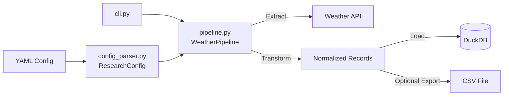

# Declarative Weather ETL

A declarative, YAML-driven ETL pipeline for extracting weather metrics, transforming observation payloads, persisting records into DuckDB, and exporting CSVs.

---

## Architecture



---

## Features

* **Declarative Configurations**: Define database targets, time windows, locations, and weather metrics inside YAML files.
* **Type-Safe Date Coercion**: Handles ISO date strings, `datetime.date`, and `datetime.datetime` instances across models and API clients seamlessly.
* **Strict Validation**: Enforce schema constraints and coordinate boundaries prior to pipeline execution using Pydantic.
* **Dynamic API Routing**: Automatically routes requests to the Open-Meteo Archive API for historical dates or the Forecast API for active timeframes.
* **DuckDB Storage**: Automated target table creation and record batch ingestion into DuckDB.
* **CSV Export**: Configurable post-ingestion dataset exports.

---

## Project Structure

```text
declarative_weather_etl/
├── data/                         # Local DuckDB storage (git ignored)
├── exports/                      # Generated CSV exports (git ignored)
├── tests/
│   ├── configs/
│   │   ├── invalid_schema.yaml
│   │   ├── valid_archive.yaml
│   │   └── valid_forecast.yaml
│   ├── conftest.py
│   ├── test_api.py
│   └── test_cli.py
├── .gitignore
├── __init__.py                  # Package root initializer
├── api_client.py                # Weather API HTTP request handler with dynamic routing
├── cli.py                       # Command-line interface entrypoint
├── config.syntax.yaml          # Reference schema documentation
├── config_parser.py             # Pydantic schema validation model
├── duckdb_loader.py             # DuckDB connection & ingestion layer
├── example.yaml                 # Active execution configuration
├── ingestor.py                  # Extract & transform processing logic
├── metrics.py                   # Metric processing & normalization
├── pipeline.py                  # Pipeline orchestrator
├── pytest.ini                   # Pytest execution configuration
├── README.md                    # Project documentation
└── requirements.txt             # Dependency manifest

```

---

## Module Reference

### `config_parser.py`

#### `ResearchConfig`

* **Definition**: `class ResearchConfig(BaseModel)`
* **Description**: Pydantic configuration schema validating database settings, execution parameters, date boundaries, geographic locations, and requested metrics. Converts ISO date strings to standard Python `datetime.date` objects upon validation.

#### `ResearchConfig.load_from_yaml`

* **Definition**: `def load_from_yaml(cls, path: str | Path) -> ResearchConfig`
* **Description**: Reads a target YAML file from disk, parses raw key-value mapping, and constructs a validated `ResearchConfig` instance. Raises `ValidationError` on bad schema or invalid inputs.

---

### `pipeline.py`

#### `WeatherPipeline`

* **Definition**: `class WeatherPipeline`
* **Description**: Core ETL pipeline orchestrator initialized with a YAML path or validated `ResearchConfig`. Manages API extraction calls, payload transformations, DuckDB persistence, and CSV writing.
* **Constructor**: `def __init__(self, config: str | Path | ResearchConfig, api_client: WeatherAPIClient | None = None, loader: DuckDBLoader | None = None)`

#### `WeatherPipeline.run`

* **Definition**: `def run(self) -> list[dict[str, Any]]`
* **Description**: Executes end-to-end pipeline processing (Extract, Transform, Load to DuckDB, optional CSV write) and returns a list of normalized observation record dictionaries.

#### `run_pipeline`

* **Definition**: `def run_pipeline(config: str | Path | ResearchConfig) -> list[dict[str, Any]]`
* **Description**: Functional API wrapper that loads configuration, instantiates `WeatherPipeline`, and executes `run()`.

---

### `cli.py`

#### `main`

* **Definition**: `def main() -> None`
* **Description**: CLI entrypoint that parses `--config` command-line flags, invokes `run_pipeline()`, and prints execution metrics to console. Handles pipeline execution errors gracefully with console output.

---

### `api_client.py`

#### `WeatherAPIClient`

* **Definition**: `class WeatherAPIClient`
* **Description**: Manages raw HTTP communication with external Open-Meteo endpoints, handling request parameter formatting, response validation, and resilient date type coercion.

#### `WeatherAPIClient._normalize_date`

* **Definition**: `@staticmethod def _normalize_date(val: str | date | datetime) -> date`
* **Description**: Normalizes strings, `datetime`, or `date` inputs into a `datetime.date` object.

#### `WeatherAPIClient.fetch_location_metrics`

* **Definition**: `def fetch_location_metrics(self, latitude: float, longitude: float, start_date: str | date | datetime, end_date: str | date | datetime, api_params: list[str]) -> dict[str, Any]`
* **Description**: Dynamic endpoint router: queries `archive-api.open-meteo.com` if `end_date < date.today()`, otherwise queries `api.open-meteo.com`.

---

### `ingestor.py`

#### `WeatherIngestor`

* **Definition**: `class WeatherIngestor`
* **Description**: Implements chunked extraction and transformation workflows. Coordinates API fetching across locations and normalizes raw nested JSON time-series payloads into flat observation dicts.

#### `WeatherIngestor._normalize_date`

* **Definition**: `@staticmethod def _normalize_date(val: Any) -> date`
* **Description**: Safely converts `str`, `datetime`, or `date` configuration parameters into `datetime.date` instances to prevent runtime `TypeError` issues during date arithmetic.

#### `WeatherIngestor.fetch_all`

* **Definition**: `def fetch_all(self) -> list[dict[str, Any]]`
* **Description**: Iterates through target locations and time window batches (`batch_size_days`), fetching and flattening metrics into standardized database records.

---

### `duckdb_loader.py`

#### `DuckDBLoader`

* **Definition**: `class DuckDBLoader`
* **Description**: Handles DuckDB connection lifecycles, dynamic DDL table creation (`CREATE TABLE IF NOT EXISTS`), transactional record upserts, and CSV export streaming.

---

### `metrics.py`

#### `METRIC_REGISTRY`

* **Definition**: `METRIC_REGISTRY: dict[str, MetricDefinition]`
* **Description**: Canonical lookup table mapping user-facing metric aliases (`air_temp`, `humidity`, `precipitation`, etc.) to Open-Meteo API parameters, units, and target DuckDB column data types.

---

### `tests/` Suite

#### `tests/conftest.py`

* **`config_paths()`**
* **Definition**: `@pytest.fixture def config_paths() -> dict[str, Path]`
* **Description**: Pytest fixture providing file paths to YAML test fixtures (`valid_archive.yaml`, `valid_forecast.yaml`, `invalid_schema.yaml`).

#### `tests/test_api.py`

* **`test_weather_pipeline_execution()`**
* **Definition**: `@pytest.mark.parametrize(...) def test_weather_pipeline_execution(...)`
* **Description**: Tests pipeline instantiation, record extraction, and DuckDB loading across valid YAML test configs.
* **`test_run_pipeline_functional_api()`**
* **Definition**: `def test_run_pipeline_functional_api(tmp_path: Path)`
* **Description**: Validates the functional programmatic wrapper `run_pipeline()`.
* **`test_invalid_yaml_schema_raises_validation_error()`**
* **Definition**: `def test_invalid_yaml_schema_raises_validation_error()`
* **Description**: Asserts that malformed configuration files fail early during validation.

#### `tests/test_cli.py`

* **`test_cli_execution()`**
* **Definition**: `def test_cli_execution()`
* **Description**: Validates CLI entrypoint argument handling, process execution, and exit codes.

---

## Usage

> **Note**: Execute commands from the root directory `declarative_weather_etl/`.

### Installation

```bash
pip install -r requirements.txt

```

### Run via CLI

```bash
python cli.py --config example.yaml

```

### Run via Python API

```python
from pipeline import run_pipeline

records = run_pipeline("example.yaml")
print(f"Loaded {len(records)} records.")

```

---

## Testing

Execute test suite via Python module execution:

```bash
python -m pytest tests/

```

Run test suite with coverage report:

```bash
python -m pytest --cov=. tests/

```