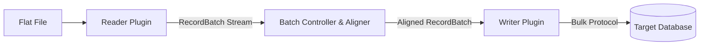

# Zero-Copy File-to-Database Loader Engine

A high-throughput, zero-copy data ingestion engine designed to stream flat files directly into databases using PyArrow memory buffers without out-of-memory (OOM) crashes.

---

## Key Features

* **Zero-Copy Memory Model**: Streams PyArrow `RecordBatch` buffers directly from files to database memory spaces without loading full datasets into RAM.
* **Pluggable & Extensible**: Modular plugin architecture allowing quick additions of custom readers and database writers.
* **Auto-DDL & Type Alignment**: Dynamically creates missing target tables (`CREATE TABLE IF NOT EXISTS`) and coerces data types on the fly.
* **Dual Interface**: Supports both programmatic Python SDK integration and a terminal-driven CLI wrapper.

---

## Supported Plugins & Extensibility

The engine resolves components dynamically at runtime. You can extend functionality by inheriting from base contracts in `core/base.py`.

### Reader Plugins

| Reader Type | Source Format | Base Contract | File Module | Extension Point |
| --- | --- | --- | --- | --- |
| `parquet` | Apache Parquet | `BaseReader` | `readers/parquet.py` | Add subclass to `readers/` & register in `readers/__init__.py` |
| `csv` | Delimited CSV | `BaseReader` | `readers/csv.py` | Add subclass to `readers/` & register in `readers/__init__.py` |
| `ndjson` | Newline Delimited JSON | `BaseReader` | `readers/ndjson.py` | Add subclass to `readers/` & register in `readers/__init__.py` |

### Writer Plugins

| Writer Type | Target Engine | Bulk Protocol | Base Contract | File Module | Extension Point |
| --- | --- | --- | --- | --- | --- |
| `duckdb` | DuckDB | In-Memory PyArrow Binding | `BaseWriter` | `writers/duckdb.py` | Add subclass to `writers/` & register in `writers/__init__.py` |
| `postgres` | PostgreSQL | Native `COPY FROM STDIN` | `BaseWriter` | `writers/postgres.py` | Add subclass to `writers/` & register in `writers/__init__.py` |
| `clickhouse` | ClickHouse | Binary Arrow Streaming | `BaseWriter` | `writers/clickhouse.py` | Add subclass to `writers/` & register in `writers/__init__.py` |

---

## Architecture & Data Flow

### Stream Processing Architecture



### Folder Structure

```text
zero_copy_file_to_database_loader_engine/
├── core/         # Core orchestration engine, registry, schema aligner, and base interfaces
├── readers/      # File reader implementations (Extensible: Parquet, CSV, NDJSON)
├── writers/      # Database writer implementations (Extensible: DuckDB, Postgres, ClickHouse)
├── examples/     # Mock data generator, SDK demos, and CLI workflows (See examples/README.md)
├── cli.py        # Command-line interface entrypoint
├── .gitignore    # Git tracking exclusion rules
├── requirements.txt # Project Python dependencies
└── README.md     # Project documentation

```

---

## Environment Setup

```bash
# Create and activate virtual environment
python -m venv venv

# Windows (cmd.exe)
venv\Scripts\activate

# Linux / macOS
source venv/bin/activate

# Install dependencies
pip install -r requirements.txt

```

---

## CLI Usage

Run ingestion pipelines directly from your terminal using `cli.py`:

### CLI Options

| Argument | Required | Description |
| --- | --- | --- |
| `--reader` | Yes | Source file reader type (`parquet`, `csv`, `ndjson`) |
| `--writer` | Yes | Target database writer type (`duckdb`, `postgres`, `clickhouse`) |
| `--source` | Yes | Path to source data file |
| `--target` | Yes | Connection string, database file path, or host URI |
| `--table` | Yes | Target database table name |
| `--batch-size` | No | Batch row limit per stream chunk (default: `50000`) |

### Windows Command Prompt (`cmd.exe`)

```cmd
python cli.py ^
  --reader parquet ^
  --writer duckdb ^
  --source examples/data/users.parquet ^
  --target examples/data/analytics.duckdb ^
  --table users ^
  --batch-size 25000

```


---

## SDK & Workflow Usage

You can import it as a library directly inside Python workflows:

```python
from core import PluginRegistry, IngestionEngine
from readers import register_readers
from writers import register_writers

# Initialize Registry & Core Engine
registry = PluginRegistry()
register_readers(registry)
register_writers(registry)

engine = IngestionEngine(registry)

# Programmatic Stream Load
metrics = engine.run(
    reader_type="parquet",
    writer_type="duckdb",
    file_path="examples/data/users.parquet",
    connection_string="examples/data/analytics.duckdb",
    table_name="users",
    batch_size=25000
)

print(f"Successfully processed {metrics['total_rows']} rows.")

```

For complete, runnable **SDK demo scripts** and **CLI execution commands**, refer to the [examples](./examples/)

---

## Extending the Engine

Adding a new file format or database target takes three simple steps:

1. **Inherit** from `BaseReader` or `BaseWriter` in `core/base.py`.
2. **Implement** required streaming methods (`read_batches` or `write_batch`).
3. **Register** your class with the `PluginRegistry`.

```python
# Example: Adding a custom Avro Reader
from core.base import BaseReader
import pyarrow.dataset as ds

class AvroReader(BaseReader):
    stage = "reader"
    type = "avro"

    def read_batches(self, batch_size: int):
        dataset = ds.dataset(self.file_path, format="avro")
        return dataset.to_batches(batch_size=batch_size)

```

---